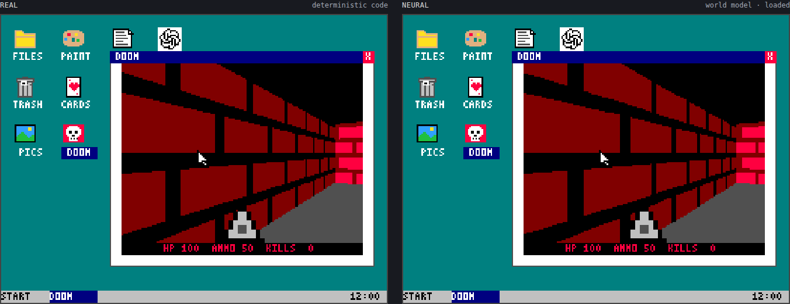
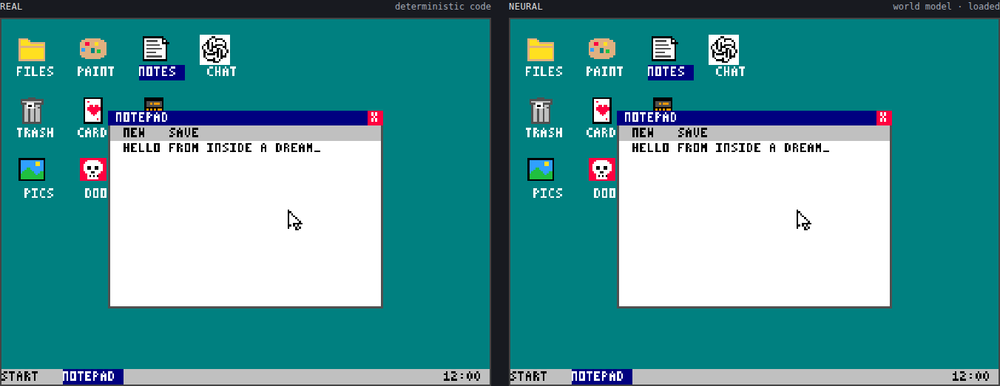
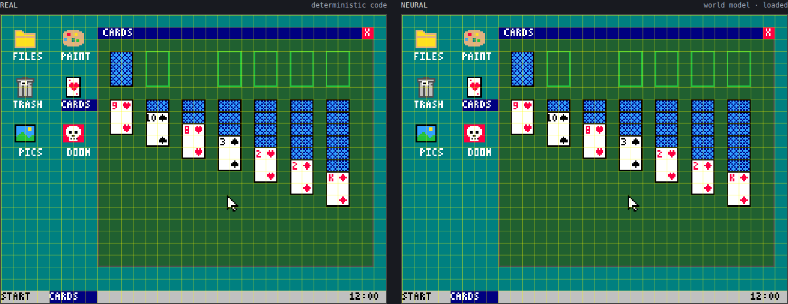
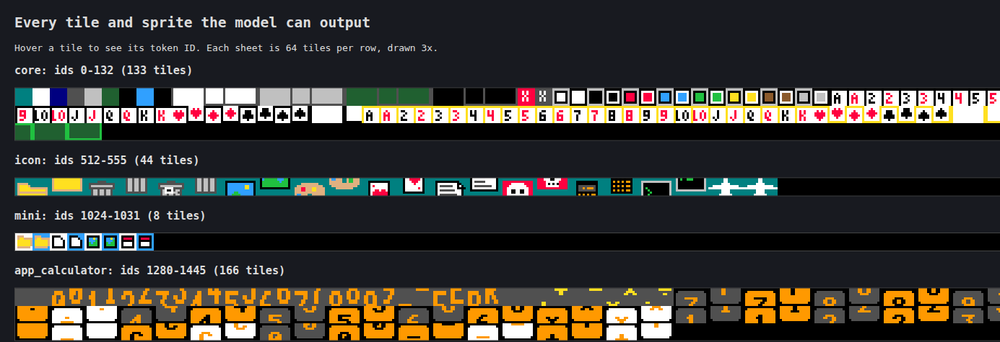
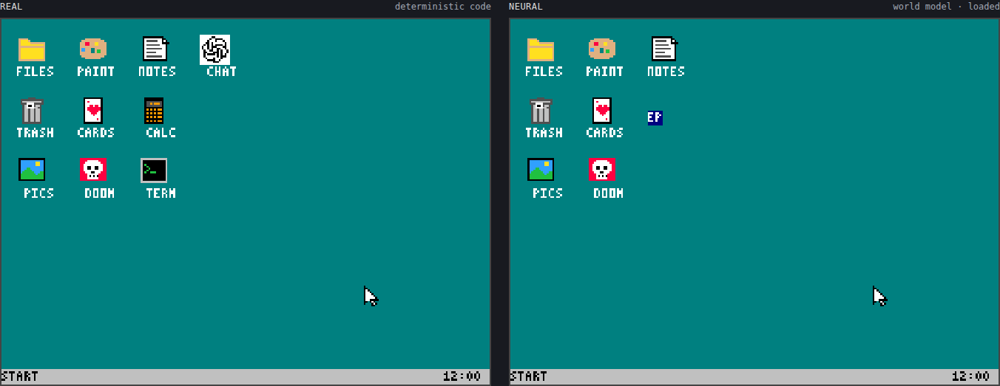
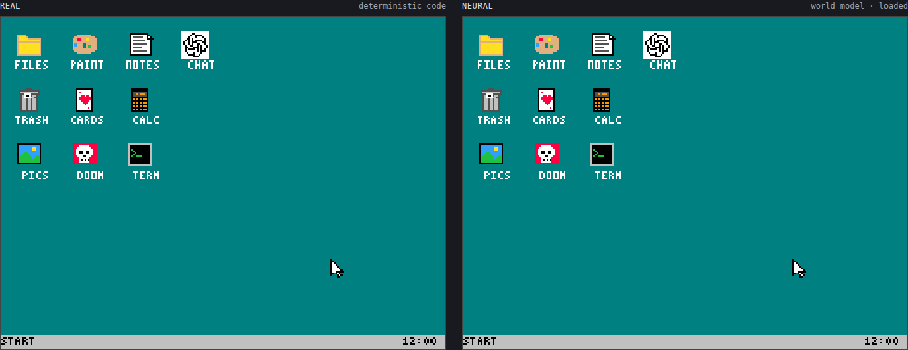

# Dreaming Machine

What if a neural network could become a computer?



Before you open an app on your phone, you can already picture it: where the buttons are, what happens when you tap one, what the next screen will be. Nothing is compiled in your head. You learned it by watching and using it. This project tries to teach a model the same thing.

Try it live: https://jasonlovesdoggo--dreaming-computer.modal.run

## What it does

On the left is a real computer running compiled code. On the right is the same computer imagined by a neural network: no OS, no apps, no game engine. Each frame, the model sees only the current screen, your mouse and keyboard input, and a small memory it writes for itself. From that it predicts the next frame, then feeds that prediction back in, again and again. Everything on the right, including Doom, is dreamed.



## How it works

**Screens are tokens.** The screen is a 32×24 grid of 8×8-pixel tiles, and each tile comes from a fixed catalogue: a pair of letters, an icon corner, a piece of a card. A frame is 768 tokens, so predicting the next screen means predicting 768 tokens.



A slice of the tile catalogue (the demo's `/sprites` page shows all of it):



**Doom is columns.** Its view is split into 160 thin vertical columns, each described by one token: which wall, how tall it looks, and its texture. A few extra tokens mark where enemies are. The model predicts these, and a simple renderer draws the picture.

**A scripted user makes the data.** It uses the computer the way a person would: curved, slightly shaky mouse paths, human click timing, and goals like opening a file, typing a note or hunting enemies. It spends more time on whatever it has done least, and sometimes just clicks and mashes keys at random so the model learns that most inputs do nothing. In total it generated over 20 million frames.

**The model** is a 12-layer transformer that predicts the whole next frame at once. It carries a small set of memory tokens from frame to frame, so it can remember things you can't see, like where you're standing in Doom. It also answers questions about the computer's hidden state, such as which app is open or how much health you have, which forces it to keep track of what's really going on. During training we sometimes feed it its own predictions and scramble a few tiles, so it learns to recover from its own mistakes.

## How it progressed

At 5,000 training steps, the dream fell apart if you clicked on empty space. By 60,000 steps, you could play Doom inside it with high consistency.

Same input, a few clicks on empty desktop:

| 5,000 steps | 60,000 steps |
| --- | --- |
|  |  |

## Running it

```bash
python -m dreaming.dataset --out data/local --steps 400000           # generate some frames
python -m dreaming.train --data data/local --out runs/local          # train (GPU recommended)
python -m dreaming.demo --ckpt runs/local/ckpt.pt --data data/local  # real vs dreamed, in the browser
```

Large-scale data generation and training run on [Modal](https://modal.com) via `modal_app.py` and `cluster_run.py` (see [docs/cluster-run.md](docs/cluster-run.md)). The demo's telemetry and training-metrics pages are documented in [docs/web.md](docs/web.md).
